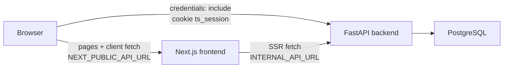
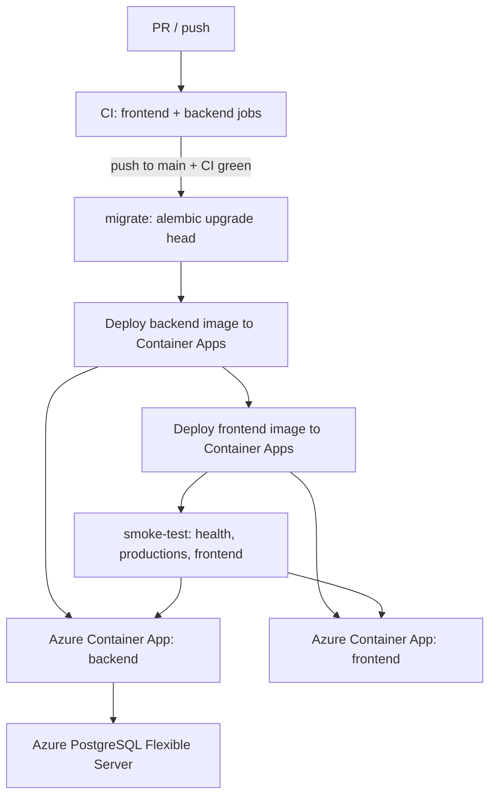
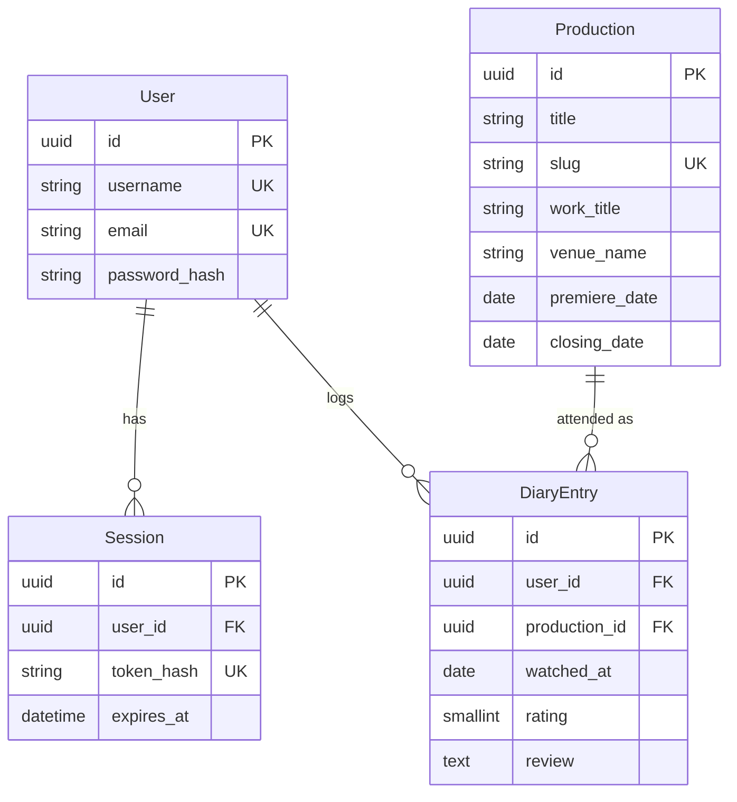

# Architecture

Current implemented architecture of Theatre Social. This document describes what
exists in the repository today — not proposed future design.

For setup and feature-level API/UI details, see [README.md](../README.md).
For planned work, see [roadmap.md](roadmap.md).

## 1. System overview

Theatre Social is a monorepo with three runtime pieces:

1. A **Next.js** frontend (browse catalogue, auth UI, diary).
2. A **FastAPI** backend (HTTP API, auth, business logic).
3. A **PostgreSQL** database (schema managed by Alembic).

Locally they run via `compose.yml`. In production, frontend and backend each
run as Azure Container Apps images; the database is Azure Database for
PostgreSQL Flexible Server. GitHub Actions runs CI on every push/PR to `main`
and CD (migrate → deploy backend → deploy frontend) only after CI succeeds on
pushes to `main`.

## 2. Technology stack and responsibilities

| Component | Responsibility | Key choices (verified in repo) |
| --- | --- | --- |
| `frontend/` | UI, SSR catalogue pages, client auth/diary | Next.js `15.5.22`, React 19, TypeScript, pnpm `10.34.5`, Node `20.20.2`, Vitest |
| `backend/` | REST API, sessions, domain services | FastAPI, SQLAlchemy 2 async, asyncpg, Alembic, Pydantic v2, uv, Python ≥ 3.12 |
| PostgreSQL | Persistence | Local: Postgres 16 via Compose. Production target: Azure Flexible Server 16 |
| Compose | Local multi-service orchestration | `compose.yml` — Podman or Docker |
| GitHub Actions | CI + CD | `.github/workflows/ci.yml` |
| ghcr.io | Container image registry for CD | Backend/frontend images tagged with commit SHA |

No Azure SDKs appear in application code. Portability is intentional: standard
HTTP, containers, env vars, and PostgreSQL.

## 3. High-level architecture



Production deployment path:



## 4. Frontend structure and data fetching

```text
frontend/
├── app/                  # App Router routes (Server Components by default)
│   ├── page.tsx          # Home + health
│   ├── productions/      # Catalogue list + [slug] detail
│   ├── diary/            # Authenticated diary page
│   ├── login|register|me/
│   └── layout.tsx        # AuthProvider + Nav
├── components/           # UI; interactive pieces are Client Components
└── lib/                  # Typed API clients (api, productions, auth, diary)
```

**Two API base URLs:**

| Variable | Used where | Typical local value |
| --- | --- | --- |
| `INTERNAL_API_URL` | Server Components / Node server | Compose: `http://backend:8000` |
| `NEXT_PUBLIC_API_URL` | Browser client code (inlined at build) | `http://localhost:8000` |

Catalogue list/detail pages fetch on the server with `cache: "no-store"`.
Auth state, login/register, diary, and “log this production” run as Client
Components against `NEXT_PUBLIC_API_URL` with `credentials: "include"`.

`next.config.ts` sets `output: "standalone"` for the production Docker image
(`frontend/Dockerfile.prod`).

## 5. Backend architecture and request flow

```text
backend/app/
├── api/routes/     # HTTP adapters (auth, diary, productions, health)
├── api/deps.py     # get_current_user
├── schemas/        # Pydantic request/response DTOs + validation
├── services/       # Business logic, queries, ownership
├── models/         # SQLAlchemy ORM
├── db/             # engine, session, seed
├── core/           # settings, security, slugify, ratings
└── main.py         # FastAPI app + CORS
```

Typical authenticated write:

```text
Request → route → Pydantic schema → service → AsyncSession / model
                 ↘ domain exception → HTTPException (status mapping)
```

CORS uses an explicit origin allowlist (`CORS_ORIGINS`) with
`allow_credentials=True` so the session cookie can be used cross-origin.

## 6. Domain model and entity relationships



**Boundaries that matter:**

- **Production** is the only catalogue entity. `work_title`, `creator_names`,
  `company_name`, `director_name`, `venue_name`, `city`, and `country_code` are
  optional strings on the same row — Work/Venue/Person tables do not exist yet.
- **DiaryEntry** is an attendance record, not a unique “user × production”
  rating. There is no unique constraint on `(user_id, production_id)`.
- **Cascade asymmetry:** deleting a User cascades to Sessions and DiaryEntries;
  deleting a Production that still has diary rows is **restricted** (API returns
  `409 Conflict`).
- Ratings: API/UI use 0.5–5.0 half-stars; DB stores `SMALLINT` 1–10 via
  `app/core/ratings.py`.

Migrations: `0001_initial` → `0002_create_productions_table` →
`0003_create_users_and_sessions_tables` → `0004_create_diary_entries_table`.

## 7. Authentication, sessions, and authorization

- Registration/login create a server-side `Session` and set an HTTP-only cookie.
- Cookie holds an opaque token; DB stores `SHA-256(token)`.
- Passwords hashed with Argon2id (`pwdlib`).
- `GET /api/v1/auth/me` and diary routes require `get_current_user`.
- Cookie flags derive from `ENVIRONMENT`:
  - development: `Secure=false`, `SameSite=Lax`
  - otherwise: `Secure=true`, `SameSite=None` (required when frontend and
    backend are on different production hostnames)

There are no roles, OAuth providers, password reset, or email verification in
the current codebase. Authorization beyond “authenticated user owns this diary
entry” is not implemented.

Feature-level auth limitations remain documented in the README’s
[Users & Authentication](../README.md#users--authentication) section.

## 8. Database persistence and Alembic

- Async engine: `create_async_engine` with `pool_pre_ping=True` and
  `connect_args={"ssl": settings.database_ssl_mode}`.
- `DATABASE_SSL_MODE` defaults to `prefer` (local/CI). Production uses `require`.
  Do **not** append `?sslmode=...` to `DATABASE_URL` for asyncpg — see README
  [Database SSL](../README.md#database-ssl).
- Alembic `env.py` builds its own async engine and must apply the same SSL
  connect args.
- Seed data (`python -m app.db.seed`) is idempotent by Production `slug` and is
  **not** run by CD.

## 9. Testing strategy

| Area | Tooling | Notes |
| --- | --- | --- |
| Backend | pytest + pytest-asyncio + httpx | Real Postgres; tables truncated between tests |
| Frontend | Vitest + React Testing Library + jsdom | Component/API-client behavior |
| CI backend | ruff check/format, `alembic upgrade head`, pytest | Service container Postgres 16 |
| CI frontend | eslint, tsc, vitest, `pnpm build` | Placeholder API URLs at build |

Tests mirror layering: route/API behavior on the backend; component + client
helpers on the frontend. Prefer extending existing suites over introducing a
parallel test stack.

## 10. CI/CD and Azure deployment architecture

Single workflow file: `.github/workflows/ci.yml`.

| Job | When | Role |
| --- | --- | --- |
| `frontend` / `backend` | Every push/PR to `main` | Quality gate |
| `smoke-script` | Every push/PR (no `if:`) | Mock-HTTP tests for `scripts/smoke-prod.sh` + actionlint on workflows |
| `migrate` | Push to `main` after CI | `alembic upgrade head` against `PROD_DATABASE_URL` |
| `deploy-backend` | After migrate | Build/push `Dockerfile.prod` → `az containerapp update` |
| `deploy-frontend` | After backend deploy | Same; `NEXT_PUBLIC_API_URL` from `BACKEND_PUBLIC_URL` |
| `smoke-test` | After frontend deploy | Sequential public GETs: `/health`, `/api/v1/productions`, frontend `/` |

**Concurrency:** workflow-level group on `main` (`cancel-in-progress: false`) is
the **primary** serialization of a full run (CI through smoke). A newer pending
main run can replace an older pending one — not every commit is necessarily
deployed. Serializing whole main runs delays CI as well as CD; accepted at
current scale. Job-level `cd-production` on migrate / deploy-* / smoke-test is
limited defense in depth (no overlapping individual production jobs); it cannot
keep sequences uninterrupted if workflow-level serialization is removed. Deploy
CLI success ≠ verified serving — smoke is the verification gate.

Azure login uses OIDC (`azure/login`) with:

- `vars.AZURE_CLIENT_ID`, `vars.AZURE_TENANT_ID`, `vars.AZURE_SUBSCRIPTION_ID`
- `secrets.PROD_DATABASE_URL` for migrations
- `vars.BACKEND_PUBLIC_URL` / `vars.FRONTEND_PUBLIC_URL` for smoke (and frontend build)

Operational detail (resource names, manual Azure setup, costs, rollback) lives
in the README [Production Deployment](../README.md#production-deployment)
section — this document only captures the architectural shape.

## 11. Important architectural tradeoffs

| Decision | Tradeoff |
| --- | --- |
| Flat Production metadata (no Work/Venue entities) | Faster MVP catalogue; harder later identity/dedup of works and venues |
| Server-side session cookie (not JWT) | Simpler revocation/hashing story; cross-site cookie/`SameSite` care in production |
| Diary allows multiple attendances | Correct theatre “rewatch” model; no single aggregate rating per user×production |
| Production delete restricted when diary exists | Protects user history; catalogue cleanup needs a future archive strategy |
| Container Apps + ghcr.io | Low idle cost / portable images; public DB access for CD migrations is an MVP compromise |
| `DATABASE_SSL_MODE` setting | Correct for asyncpg; callers must not assume libpq URL query params |

## 12. Known technical limitations (cross-cutting)

Feature-specific limitations (catalogue streaming `notFound` status, auth
password-reset gaps, diary UI pagination, etc.) are maintained in the README
feature sections. Cross-cutting system limits:

- Production catalogue write APIs exist, but there is no authenticated admin /
  curation UI — seed script and API are the write paths.
- No Redis/queues/background workers; expired sessions are cleaned
  opportunistically on lookup only.
- Observability is logs + `/health` only (no APM/tracing stack in-repo).
- Production networking assumes public HTTPS between frontend, backend, and a
  publicly reachable Postgres for the GitHub-hosted migrate job (documented MVP
  compromise in the README).
- Domain identity of a “production” beyond slug/title metadata is unresolved —
  see [Open architectural questions](roadmap.md#open-architectural-questions).
